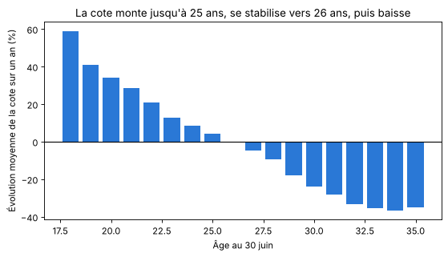
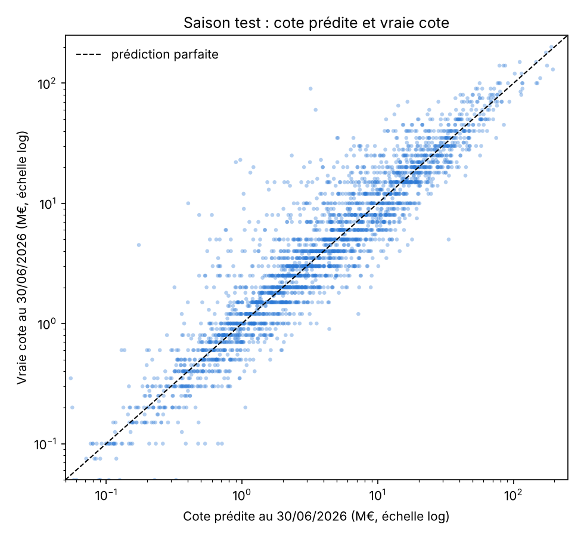
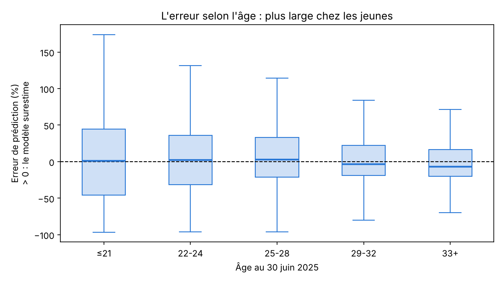

# Combien vaudra un joueur dans un an ?

Réponse courte : surtout son âge. Les buts et les passes de la saison passée aident beaucoup moins que je ne le pensais.

Dans mon projet de fin de formation ([Valorisation des joueurs du Big 5](https://github.com/jmeignen/valorisation-joueurs-big5)), j'estimais ce qu'un joueur vaut aujourd'hui au vu de ses performances. Une cellule de recrutement veut aussi savoir ce qu'il vaudra l'an prochain, pour acheter avant que son prix ne monte ou vendre avant qu'il ne baisse. J'ai donc entraîné un modèle sur 12 ans d'historique Transfermarkt (2014-2026) et de statistiques de match, puis je lui ai fait prédire la cote au 30 juin 2027 de 3 014 joueurs du Big 5, avec une fourchette.

*Python : pandas, scikit-learn (régression linéaire, gradient boosting, régression quantile).*

## Ce que je croyais, et ce que les données disent

Je m'attendais à ce que la saison écoulée (buts, passes décisives, temps de jeu) soit le meilleur indice. En réalité, elle ne fait presque rien gagner au modèle : l'erreur passe de 0,381 à 0,378. Même chose pour les résultats du club. L'explication tient en une phrase : Transfermarkt met à jour les cotes pendant la saison, donc au 30 juin, les performances sont déjà dans le prix.

Ce qui fait vraiment bouger une cote, c'est l'âge. En moyenne, elle prend environ 40 % en un an à 19 ans, se stabilise vers 26 ans et perd près de 30 % à 31 ans. À âge égal, une cote qui vient de monter continue un peu (+4 % pour une hausse de 50 %), un joueur de grand club progresse un peu plus (+6 %), et une cote déjà haute progresse moins en pourcentage.

## Est-ce que le modèle est bon ?

Testé sur la saison 2025 → 2026, qu'il n'avait jamais vue :

| | Erreur pour un joueur typique | Bon sens quand la cote bouge de plus de 5 % |
|---|---|---|
| Supposer que la cote ne bouge pas | ×1,40 | |
| Courbe d'âge seule | ×1,33 | 35 % |
| Gradient boosting, avec statistiques de jeu | ×1,30 | 73 % |

C'est environ 14 % d'erreur en moins que « rien ne bouge », et le bon sens trois fois sur quatre. La fourchette tient sa promesse : 79 % des vraies cotes 2026 tombent dedans, pour 80 % visés.

| La prédiction suit la vraie cote… | …avec plus d'erreur chez les jeunes |
|---|---|
|  |  |

## Ce qu'une cellule de recrutement peut en faire

Le fichier `predictions_2027.csv` donne pour chaque joueur la cote actuelle, la cote prédite, la fourchette et l'évolution. Le notebook en tire trois listes :

- Acheter tôt : 104 joueurs à 5 M€ ou plus qui devraient prendre au moins 25 %. Presque tous (93 %) ont moins de 22 ans : Believe Munongo à Metz, Wael Mohya à Mönchengladbach, Kacper Potulski à Mayence.
- Vendre maintenant : 72 joueurs à 10 M€ ou plus dont la cote devrait baisser même dans le haut de la fourchette. Ils ont entre 29 et 33 ans, et attendre un an coûte en moyenne environ 37 % de leur valeur.
- La meilleure cible, en croisant avec le premier projet : 77 titulaires sous-cotés aujourd'hui et dont la cote devrait monter, comme Simon Ebonog au Havre, Tiago Gabriel à Lecce ou Adam Obert à Cagliari.

Ce sont des joueurs à aller voir jouer, pas des décisions d'achat : le modèle ne voit ni les blessures, ni le niveau tactique, ni les transferts.

## Le piège que j'ai voulu éviter

Le plus simple aurait été de mélanger toutes les saisons et d'en tirer un échantillon de test au hasard. Le modèle aurait alors appris sur des saisons postérieures à celles qu'il prédit, et ses résultats auraient eu l'air meilleurs qu'en vrai. J'ai donc reconstruit une photo de chaque joueur au 30 juin de chaque année, avec uniquement ce qui était connu à cette date, entraîné le modèle sur 2014-2024 et je l'ai jugé sur une seule saison qu'il n'avait jamais vue.

## Ce qui manque encore

L'historique des contrats surtout : seule la date de fin actuelle est connue, alors que mon premier projet montre qu'une année de contrat en plus vaut environ +14 %. Il manque aussi les xG et les statistiques défensives par saison. Et la cible reste la cote Transfermarkt, une estimation, pas un vrai prix de transfert. Le cadre juridique (durée des contrats, réforme des transferts après l'arrêt Diarra, joueurs mineurs) est dans [la note du premier projet](https://github.com/jmeignen/valorisation-joueurs-big5/blob/main/CADRE_JURIDIQUE.md).

## Pour le refaire

Les fichiers trop lourds pour le dépôt viennent du jeu de données [Football Data from Transfermarkt](https://www.kaggle.com/datasets/davidcariboo/player-scores) (licence CC0) : `player_valuations.csv` (obligatoire), `appearances.csv` (statistiques de match) et `games.csv` (seulement pour le test sur les résultats du club), à placer dans `donnees/`. Ensuite `pip install pandas numpy matplotlib scikit-learn`, et dans le notebook [prediction_cote_2027.ipynb](prediction_cote_2027.ipynb), Kernel → Restart & Run All (quelques minutes). Sans `appearances.csv`, il tourne quand même, sans les statistiques de jeu.

Justine Meignen
